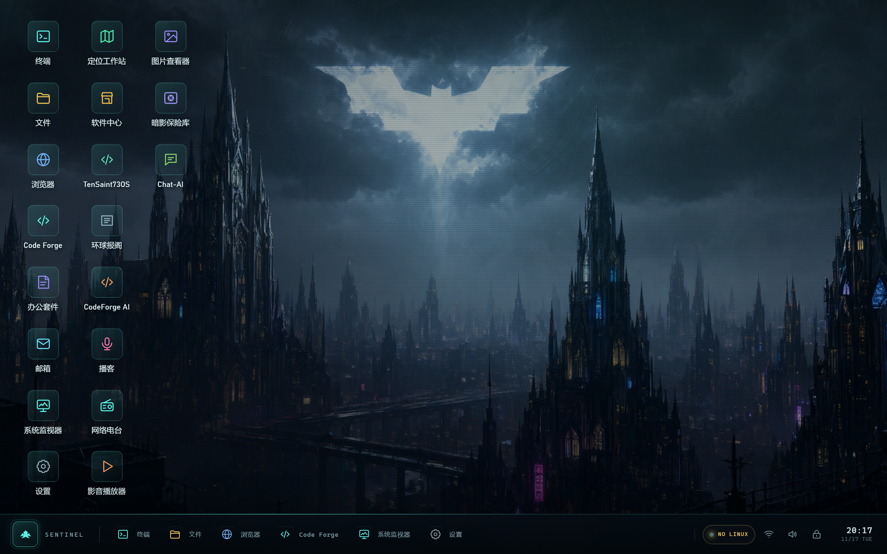
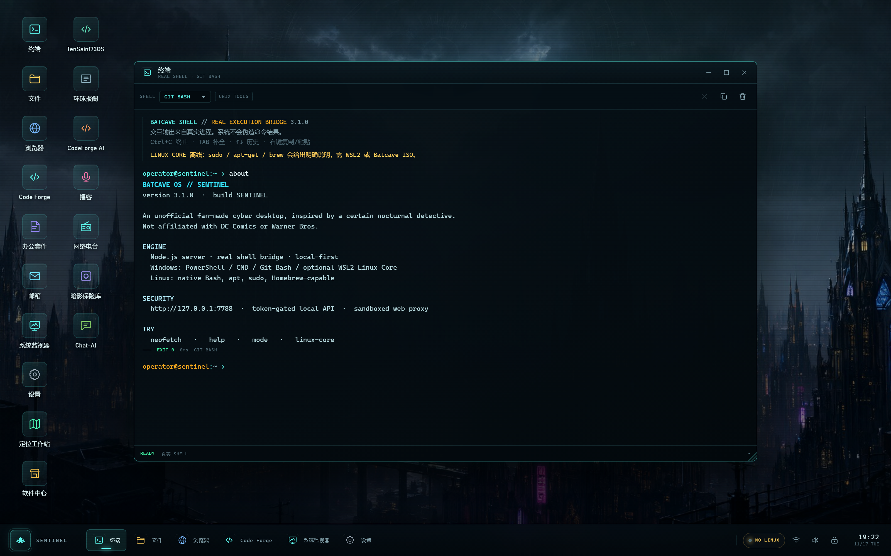
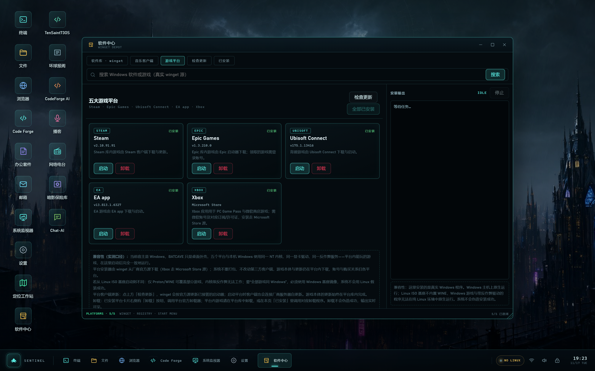
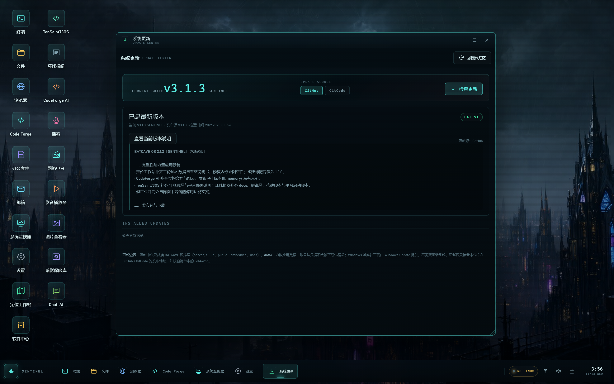
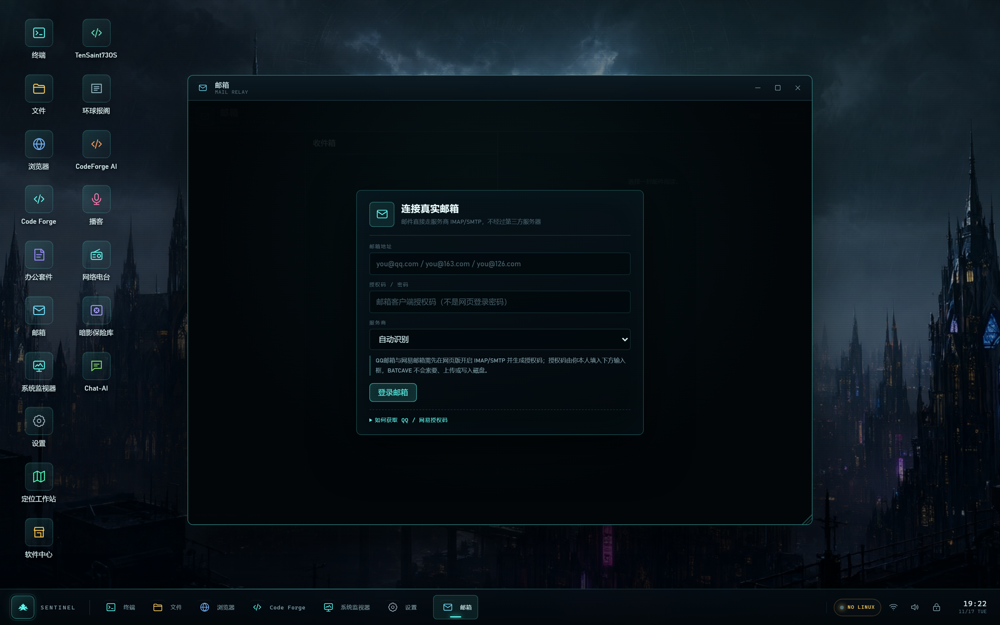
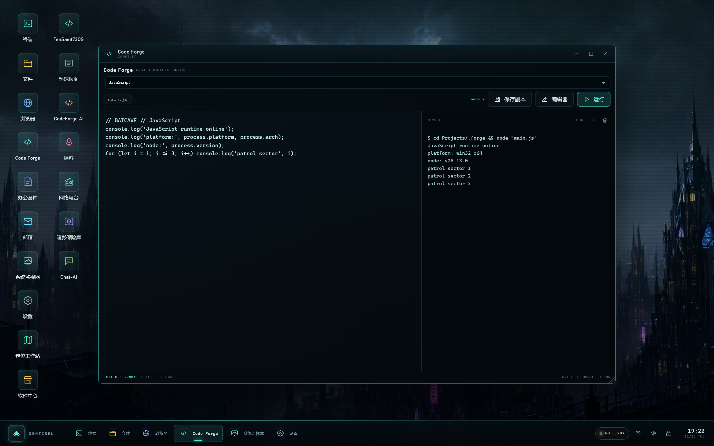
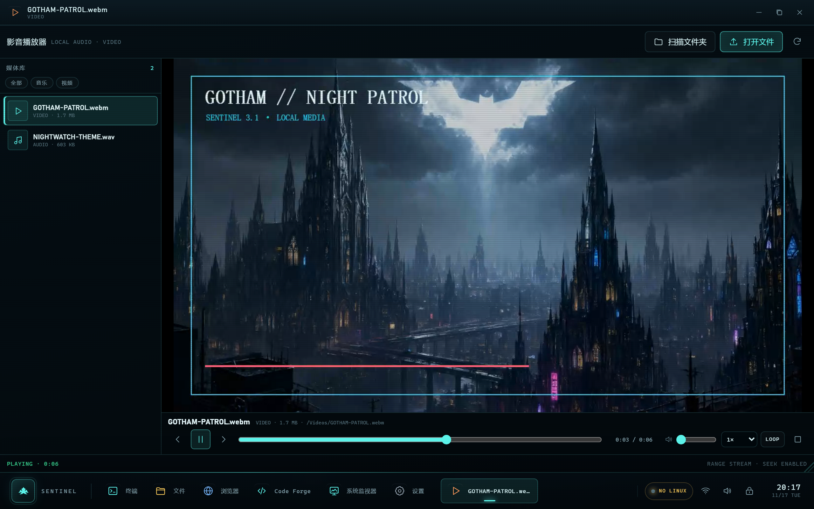
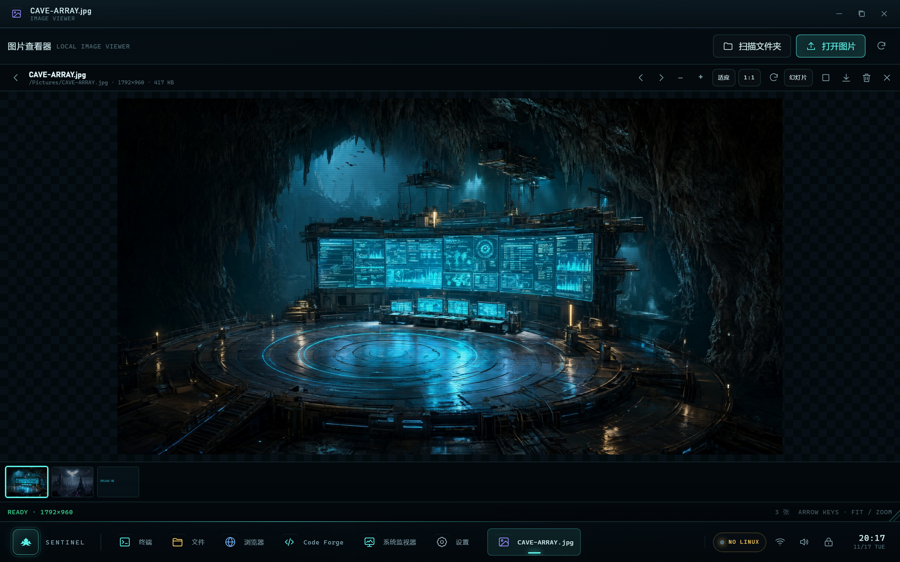
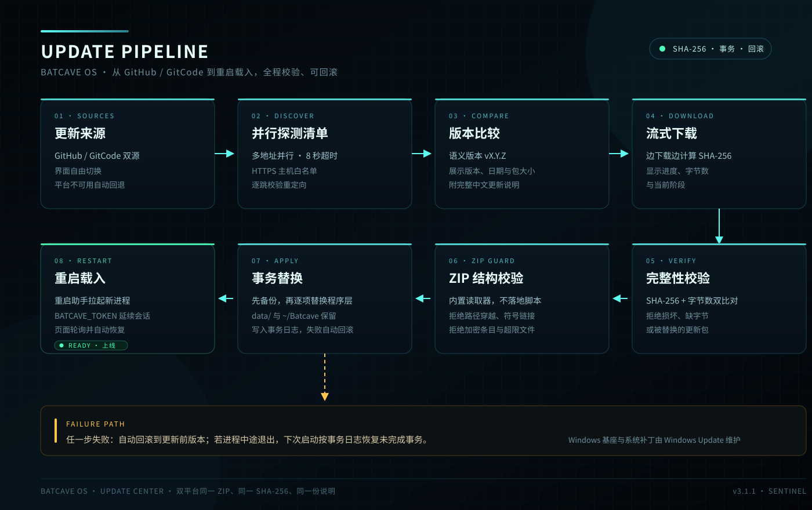

# BATCAVE OS v3.1.3 · SENTINEL

一个可离线运行、可制作成可启动 Windows 安装 ISO 或 Windows To Go 系统盘的本地 Web 桌面。后端是零依赖的 Node.js 服务，前端是原生 JavaScript 窗口管理器；终端、编译器、网络、软件中心、邮件、内嵌应用与系统更新都调用真实能力，不是静态演示页。

**当前版本：3.1.3 SENTINEL · 发布于 2026-11-18 · MIT License**

## 下载

| 内容 | GitHub | GitCode |
| --- | --- | --- |
| 程序包 v3.1.3（ZIP，用于安装或应用内更新） | [BATCAVE-OS-3.1.3.zip](https://github.com/IAMMEZSH/BATCAVE-OS/releases/download/v3.1.3/BATCAVE-OS-3.1.3.zip) | [BATCAVE-OS-3.1.3.zip](https://gitcode.com/gcw_So3EkhfR/BATCAVE-OS/releases/download/v3.1.3/BATCAVE-OS-3.1.3.zip) |
| SHA-256 校验值 | [SHA256SUMS.txt](https://github.com/IAMMEZSH/BATCAVE-OS/releases/download/v3.1.3/SHA256SUMS.txt) | [SHA256SUMS.txt](https://gitcode.com/gcw_So3EkhfR/BATCAVE-OS/releases/download/v3.1.3/SHA256SUMS.txt) |
| 发布页与完整更新说明 | [Release v3.1.3](https://github.com/IAMMEZSH/BATCAVE-OS/releases/tag/v3.1.3) | [Release v3.1.3](https://gitcode.com/gcw_So3EkhfR/BATCAVE-OS/releases/v3.1.3) |
| 源码仓库 | [IAMMEZSH/BATCAVE-OS](https://github.com/IAMMEZSH/BATCAVE-OS) | [gcw_So3EkhfR/BATCAVE-OS](https://gitcode.com/gcw_So3EkhfR/BATCAVE-OS) |

两个平台发布**同一个 ZIP、同一个 SHA-256、同一份说明**。已安装旧版本的用户不需要重新下载镜像或重装系统，直接在应用内打开"系统更新"，选择 GitHub 或 GitCode 即可升级。

> 可启动 ISO 包含微软 Windows 安装文件，体积约 8–9 GB，并受 Windows 许可约束，**不随项目公开分发**；仓库提供构建脚本，使用自己的官方 ISO 在本机构建。Windows To Go 的 VHD 实际大小约 16–17 GB，超过 GitHub / GitCode 单个 Release 资产限制，因此发布的是**构建脚本**而非系统镜像。Windows 与激活密钥均不随项目分发，请使用自己的官方 ISO 与本机合法许可。

## 一分钟启动

要求：Windows 10/11 或 Linux，Node.js 18+。无需 `npm install`，项目零运行时依赖。

```bash
node server.js
```

浏览器自动打开 `http://127.0.0.1:7777`。常用参数：

| 参数 | 作用 |
| --- | --- |
| `--no-open` | 不自动打开浏览器 |
| `--port=7777` | 指定端口（被占用时自动顺延） |
| `--host=127.0.0.1` | 指定监听地址，默认仅回环 |
| `--kiosk` | 全屏应用模式 |
| `--tui` | 无浏览器，进入终端界面 |
| `--allow-local-net` | 允许访问局域网地址（默认禁止） |
| `--allow-destructive` | 显式放开破坏性命令（默认拦截） |

也可以双击 `start-batcave.cmd`（Windows），或使用可启动 ISO / Windows To Go 镜像中预置的开机自启快捷方式。启动脚本优先使用程序目录内的 `node.exe`，因此离线的 ISO 基座不依赖系统 PATH。

## 它是什么

BATCAVE OS 把一台 Windows 机器包装成一个"打开浏览器就能用"的桌面：

- **真实能力**：终端连接 PowerShell / CMD / Git Bash / WSL；代码工坊调用本机 GCC、Rust、Go、Java、PHP、Python、Node 编译运行；网络、软件、邮件都走系统真实接口。
- **本地优先**：没有云端账号，没有遥测。程序只监听回环地址；数据在本机 `data/` 与 `~/Batcave`。
- **可随身携带**：用官方 Windows 11 ISO 构建 x64 / ARM64 可启动安装盘或 Windows To Go VHD；安装后首次登录自动全屏进入 BATCAVE。
- **可持续更新**：内置更新中心，从 GitHub 或 GitCode 获取新版本，校验后热替换程序层并重启，不碰个人数据。
- **可审计**：纯 JavaScript，无打包器、无前端框架、无数据库依赖，源码即运行代码。

### 它不是什么

- 不是 Windows 的替代系统，也不是 Linux 发行版；它是运行在 Windows 或 Linux 之上的本地 Web 桌面。
- 不提供操作系统级沙箱。终端命令以当前用户权限执行，请只运行可信代码。
- 不含激活、第三方账号、游戏本体或任何个人凭据。
- 不绕过软件与游戏的官方渠道、账号和许可限制。

## 界面预览

| 桌面与窗口 | 真实终端 |
| --- | --- |
|  |  |

| 软件与游戏中心 | 系统更新 |
| --- | --- |
|  |  |

| 邮件 | 代码工坊 |
| --- | --- |
|  |  |

| 影音播放器 | 图片查看器 |
| --- | --- |
|  |  |

截图均来自实际运行界面；邮件页不包含任何邮箱地址或授权码。更新中心截图使用与正式清单同格式的本地联调数据，发布后实际从 GitHub / GitCode 读取。影音与图片截图使用本地测试媒体，路径均为 Home 内的相对路径。

## 功能总览

### 桌面与系统

- 开机动画、登录、任务栏、开始菜单、多窗口拖拽/吸附/最小化、桌面图标与快捷键。
- 虚拟文件系统 + 本机文件映射、记事本、计算器、日历、天气、监控、任务管理器。
- Chat-AI：本地规则对话助手，可打开应用、查询真实系统状态、转交终端命令（不会冒充云端模型）。
- 设置中心：外观、终端、网络、安全、关于。
- Windows 基座：x64 与 ARM64 双架构可启动 ISO 安装盘与 Windows To Go VHD；官方安装树保持原样，`sources\$OEM$` 注入 BATCAVE、内置 Node.js 和开机自启，构建时校验 WIM 架构、BIOS/UEFI 引导与载荷安全。

### 真实终端与工具链

- 命令桥接自动探测 PowerShell 7、Windows PowerShell、CMD、Git Bash、WSL。
- 代码工坊（Code Forge）可运行 JavaScript/TypeScript、Python、C/C++、汇编、Rust、Go、Java、Ruby、PHP、Bash、PowerShell。
- HTML/CSS 实时静态诊断（未闭合标签、CSS 声明、样式块行号偏移）与沙箱 iframe 预览。
- 编译器错误解析：文件、行、列、严重级别与消息汇总，最多展示 80 条。
- 本机实测环境：PHP 8.4、Go 1.27、Ruby 3.4、Rust 1.100、GCC + GNU as、Java 17、Node 26。

### 网络与安全

- 真实适配器、IP、连接配置读取；Wi-Fi 扫描与连接（`netsh wlan`）；以太网启用、禁用、续期。
- 浏览器安全网关：风险域名提示与拦截、沙箱化网页代理、下载隔离。
- API 仅回环监听；敏感接口要求启动时随机生成的会话令牌（`x-batcave-token`）并校验 Origin。
- 默认禁止局域网与破坏性命令，需显式参数开启。

### 软件、办公与娱乐

- Windows 软件中心：winget 搜索/安装、官方源检查更新、注册表与开始菜单枚举、按名称卸载。
- 五大游戏平台检测、启动、卸载与客户端更新入口：Steam、Epic Games、Ubisoft Connect、EA app、Xbox。
- 微信、QQ、Office / WPS / LibreOffice 接入。
- PDF 浏览与页级编辑：旋转、删除、排序、合并、页码、导出。
- 邮箱：QQ 邮箱 / 网易 163 / 126 / yeah.net 的真实 IMAP/SMTP/TLS 连接；授权码由用户本人在界面输入，凭据仅驻留内存。
- 播客与网络电台：多国目录、筛选、热门榜、HLS 播放。
- **影音播放器**：扫描 `/Music`、`/Videos`、`/Downloads`、`/Uploads` 与自定义文件夹，播放本地音频与视频；支持播放列表、进度拖动、倍速、循环、音量与全屏。`/api/fs/raw` 支持 HTTP Range，视频可任意跳转而不必整段读入内存。
- **图片查看器**：扫描 `/Pictures`、`/Gallery`、`/Uploads`、`/Downloads` 与自定义文件夹；缩略图网格、适应窗口 / 1:1 / 缩放、旋转、幻灯片、上一张 / 下一张、全屏、下载与删除。图片和媒体文件在文件管理器中双击即可用对应查看器打开。
- 三大音乐客户端接入：QQ 音乐、网易云音乐、酷狗音乐。
- 三款游戏加速器：网易UU、雷神、迅游。安装与更新时从各自官网解析当前 Windows 安装包，校验官方 HTTPS 主机与 Authenticode 厂商签名后再启动官方安装器；已安装版本、官网最新版本与更新状态分别展示。

### 内嵌应用

| 应用 | 端口 | 说明 |
| --- | --- | --- |
| TenSaint73OS | 7781 | 单管理员社区系统，论坛/文件/会员，数据隔离到 `data/apps/tensaint` |
| 环球报阁 | 7782 | 多语种报刊阅读、RSS、翻译、朗读 |
| CodeForge AI 1.0.4 | 7790 | AI 编程中枢；优先复用本机桌面完整安装（含模型与配置），否则运行发行包自带精简版 |

内嵌应用由 `lib/embedded.js` 统一管理：健康探测、按需启动、退出时终止进程树；工作区模板首次运行时复制到数据目录，不修改发行包原件。

## 系统更新中心



打开桌面或开始菜单的"系统更新"，即可在 **GitHub** 与 **GitCode** 之间切换来源。更新器会：

1. 并行请求该平台的多个清单地址，8 秒超时；失败自动回退到另一平台。
2. 比较语义版本，展示版本号、发布时间、包大小与中文更新说明。
3. 流式下载并实时计算 SHA-256，与清单中的 SHA-256 和字节数双重比对。
4. 使用内置 ZIP 读取器解压，拒绝路径穿越、符号链接、加密条目与超限文件。
5. 校验新版本结构（`server.js`、`version.json`、`lib/update.js`、前端入口、`update/sources.json`）与版本号一致性。
6. 写入事务日志后逐个替换顶层条目；任何一步失败自动回滚。
7. 点击"重启 BATCAVE"，重启助手拉起新进程并通过 `BATCAVE_TOKEN` 延续会话令牌，页面自动等待新版本上线。

**不会改变**：`data/`、`~/Batcave`、`node.exe`、Windows To Go 分区与任何个人凭据。
**不会包含**：`.tsowner`、`OWNER.pin`、`auth.json`、`system.db`。

完整机制、故障恢复与手动升级见 [更新说明](docs/UPDATE.md)。

## Windows 基座：可启动 ISO 与 Windows To Go

`iso/winbase/` 提供两种基座交付，均只使用你自己的官方 Windows 11 ISO，不修改激活，也不分发 Windows。

### 可启动 ISO：直接重装系统

ISO 保留官方安装树，只在 `sources\$OEM$` 中加入载荷：

- `$1\BATCAVE-OS` 复制到 `C:\BATCAVE-OS`，包含程序、内嵌应用、对应架构 `node.exe` 与说明。
- `$$\Setup\Scripts\SetupComplete.cmd` 在安装完成、OOBE 之前创建公共桌面、开始菜单与所有用户启动快捷方式。
- 首次登录自动以 Edge 全屏应用模式打开；程序目录授予 Users 修改权限，应用内更新可以替换程序层。
- 不写入无人值守磁盘清除，不替你选择磁盘或版本；安装界面仍由你确认目标磁盘、Windows 版本、账户与激活。

```powershell
# x64（专业版通常索引 4）
powershell -NoProfile -ExecutionPolicy Bypass -File iso\winbase\build-iso.ps1 `
  -Iso "$env:USERPROFILE\Downloads\Windows11_Client_x64_zh-cn.iso" -Index 4

# ARM64（专业版通常索引 3，必须提供 win-arm64 的 node.exe）
powershell -NoProfile -ExecutionPolicy Bypass -File iso\winbase\build-iso.ps1 `
  -Arch arm64 `
  -Iso "$env:USERPROFILE\Downloads\Windows11_Client_arm64_zh-cn.iso" -Index 3 `
  -NodeExe "D:\tools\node-v24.22.1-win-arm64.exe"
```

产物为 `iso\out\BATCAVE-OS-3.1.3.iso` 与 `BATCAVE-OS-3.1.3-arm64.iso`，相邻目录同时生成 `VERIFY-ISO*.json`、`ISO-BUILD*.json` 与 `ISO-SHA256SUMS.txt`。构建会校验：

- `install.wim` 索引名称与架构（x64 / ARM64）。
- El Torito 引导目录：x64 同时包含 BIOS 与 UEFI，ARM64 为 UEFI。
- `$OEM$` 载荷完整性、内置 `node.exe` PE 架构、安装脚本与自启快捷方式。
- 载荷中不存在 `.tsowner`、`OWNER.pin`、`auth.json`、`system.db`、`data/` 或任何任务进度组件。
- 输出 ISO 的 SHA-256、字节数、卷标与安装树完整性。

v3.1.1 本机实际构建与挂载校验结果（2026-11-17）。3.1.2 与 3.1.3 只更新程序包，未重新构建 ISO；使用同一脚本会输出 `BATCAVE-OS-3.1.3*.iso`：

| 项目 | x64 | ARM64 |
| --- | --- | --- |
| 文件 | `BATCAVE-OS-3.1.1.iso` | `BATCAVE-OS-3.1.1-arm64.iso` |
| 字节数 | 9,249,867,776 | 8,971,454,464 |
| SHA-256 | `5ae1a37ee61309cbee1e994b451ffb1b3c2cc93e8f2351ce1a026965bf728bd3` | `983e8ab5f70849aec4fcbdc36614ef03faab94c16346376c612c07f1d79e4261` |
| 引导 | BIOS + UEFI | UEFI |
| WIM 架构 | x64 | arm64 |
| 内置 Node.js | 26.13.0 / `0x8664` | 24.22.1 / `0xAA64` |
| 卷标 | `BATCAVE_OS_311_X64` | `BATCAVE_OS_311_ARM64` |
| `allCoreOk` | `true` | `true` |

> 两份 ISO 均已挂载校验安装树、引导项、WIM 架构、Node/EFI 架构与 `$OEM$` 载荷，但尚未在实体硬件上做启动回归。


> ISO 包含微软 Windows 安装文件，**项目不公开上传 ISO**；请只在自己的官方授权介质上为本机构建。构建完成不等于实体启动回归，首次安装仍建议先在备用机或虚拟机验证。

### Windows To Go VHD：Ventoy / 直写 U 盘

同一目录下的 `build-winbase.ps1` 从官方 Windows 11 ISO 离线生成可启动 VHD：

```powershell
# x64（专业版通常为索引 4）
powershell -NoProfile -ExecutionPolicy Bypass -File iso\winbase\build-winbase.ps1 `
  -Iso "$env:USERPROFILE\Downloads\Windows11_Client_x64_zh-cn.iso" -Index 4

# ARM64（专业版通常为索引 3，需提供 win-arm64 的 node.exe）
powershell -NoProfile -ExecutionPolicy Bypass -File iso\winbase\build-winbase.ps1 `
  -Arch arm64 `
  -Iso "$env:USERPROFILE\Downloads\Windows11_Client_arm64_zh-cn.iso" -Index 3 `
  -NodeExe "D:\tools\node-v24.22.1-win-arm64.exe"
```

离线校验结果（2026-11-17）：

| 项目 | x64 | ARM64 |
| --- | --- | --- |
| `allCoreOk` | `true` | `true` |
| `bootmgfw.efi` | `0x8664` | `0xAA64` |
| `winload.efi` | `0x8664` | `0xAA64` |
| `node.exe` | `0x8664` | `0xAA64` |
| VHD 实际大小 | 16,762,073,088 字节 | 17,266,372,608 字节 |

构建细节、两种基座的安装与启动、Ventoy / 直写 U 盘部署、校验报告与故障排查见 [可启动 ISO 与 Windows To Go 构建部署](docs/BUILD-ISO.md)。

> ISO 与 VHD 均已完成离线结构与引导项校验，但尚未在实体硬件上做启动回归。安装或写入前请先备份；ARM64 镜像需在 ARM64 设备上启动，x64 宿主只能构建和离线校验。

## Windows 基座要更新吗？Windows 12 怎么办？

**程序更新与系统基座是两条线，互不替代。**

- **Windows 本体**：基座里是完整 Windows，不是裁剪系统；质量更新、驱动与安全补丁继续由 Windows Update 提供。
- **BATCAVE 程序层**：应用内更新中心只替换 `server.js`、`lib`、`public`、`embedded`、`docs` 等文件，不碰 Windows 分区、引导文件、`node.exe` 与 `data/`。因此**应用升级永远不需要重装系统，也不需要重建 ISO / VHD**。
- **ISO / VHD 基座**：只有更换 Windows 大版本、调整分区或升级内嵌 `node.exe` 时才需要重新构建。
- **Windows 12 出现后**：现有 Windows 11 基座在微软支持周期内可以继续用；若要换 Windows 12 基座，把构建脚本的 `-Iso` 指向 Windows 12 官方 ISO，重新确认 WIM 索引后运行同一脚本。脚本不硬编码 Windows 11，但 DISM 映像布局、`$OEM$` 安装行为、ARM64 Node.js 与 Prism 兼容性**必须重新实测**；完成回归前不会宣称“开箱即用”。不建议在 VHD 或已安装系统盘内做跨大版本就地升级，更稳妥的是新建 ISO / VHD 后迁移 `data/` 与 `~/Batcave`。

完整实测清单见 [可启动 ISO 与 Windows To Go 构建部署 · Windows 12 与后续基座](docs/BUILD-ISO.md#windows-12-与后续基座)。

## 安全边界

| 主题 | 现状 |
| --- | --- |
| 网络暴露 | 默认仅 `127.0.0.1`，需显式参数才开放局域网 |
| 请求认证 | 每次启动随机令牌，仅注入首页，不落盘；重启更新时经环境变量延续 |
| Origin 校验 | 敏感 API 同时校验令牌与 Origin |
| 邮箱凭据 | 授权码由用户本人输入，只在单次请求内存中存在，不写日志、不写磁盘 |
| 更新完整性 | HTTPS 主机白名单 + 逐跳重定向校验 + SHA-256 + 字节数 + ZIP 结构限制 |
| 更新回滚 | 事务日志、备份目录、启动时自动恢复未完成事务 |
| 所有者身份 | 仅来自用户桌面 `.tsowner`；仓库、镜像与更新包不生成、不复制凭据 |
| 系统沙箱 | **尚未实现**；终端以当前用户权限运行 |

完整数据路径与模块说明见 [架构说明](docs/ARCHITECTURE.md)。

## 兼容性与已验证环境

- Windows 10/11 x64：主开发与实测平台。
- Linux：Node 服务与前端可运行；Shell 桥使用 `bash` / `pwsh`；Windows 专属面板会提示不可用。
- Windows 11 ARM64：已构建并离线校验 ISO 与 VHD；应用层可运行，原生组件依赖 Prism 模拟。
- Node.js 18+；本机实测 Node 26。可启动 ISO / VHD 内置对应架构运行时：当前 x64 构建使用 Node 26.13.0，ARM64 构建使用 Node 24.22.1。
- 浏览器：Chromium 内核（Edge / Chrome）效果最佳。

## 目录结构

```text
batcave-os/
├── server.js              # HTTP 服务、API 路由、令牌校验、静态资源
├── start-batcave.cmd      # Windows 双击启动（控制台）
├── start-batcave.vbs      # Windows 静默启动（供快捷方式调用）
├── lib/
│   ├── bridge.js          # 真实 Shell 桥（PowerShell/CMD/Git Bash/WSL）
│   ├── home.js            # 本机文件映射与命令执行
│   ├── network.js         # Windows 网络状态、Wi-Fi、以太网
│   ├── apps.js            # winget/注册表软件枚举、官方源更新检查、启动与卸载
│   ├── mail.js            # IMAP/SMTP 邮件桥
│   ├── embedded.js        # 内嵌应用生命周期管理
│   ├── update.js          # 双平台更新、校验、事务替换与回滚
│   └── restart-helper.js  # 更新后重启助手
├── public/                # 桌面前端（原生 JS/CSS）
├── embedded/              # 内嵌应用发行包
├── iso/
│   ├── winbase/
│   │   ├── build-iso.ps1      # 官方安装树 + $OEM$ → 可启动 ISO
│   │   ├── verify-iso.ps1     # WIM / El Torito / 载荷 / 禁入项校验
│   │   ├── build-winbase.ps1  # Windows To Go VHD 构建
│   │   └── iso-payload/       # SetupComplete、自启与安装脚本模板
│   └── out/                   # ISO、VHD、校验报告（不入库）
├── update/                # 更新来源与清单（latest.json）
├── tools/                 # 更新包打包工具
├── test/                  # 更新器单元测试
├── docs/                  # 架构、构建、更新、使用手册与图片
└── data/                  # 运行时数据（首次启动生成，不入库）
```

## 测试

```bash
node --test test/update.test.js
```

覆盖 CRC32、版本排序、路径安全、ZIP stored/deflate、路径穿越/CRC/加密拒绝、暂存结构校验、清单主机与 SHA 校验、GitHub contents API base64 包装解包、安装/备份/历史、事务中断恢复，共 10 项。

## 文档

- [使用手册（从开机到每个面板）](docs/MANUAL.md)
- [更新说明与运维指南](docs/UPDATE.md)
- [架构说明](docs/ARCHITECTURE.md)
- [可启动 ISO 与 Windows To Go 构建部署](docs/BUILD-ISO.md)
- [版本变更记录](CHANGELOG.md)
- [镜像使用说明](iso/winbase/README-FIRST.txt)

## 已知限制

- WSL / Linux Core 是否可用取决于宿主是否安装并启用 WSL；本项目提供桥接与检测，不在运行时强制安装。
- 邮箱登录需要先在网页版开启 IMAP/SMTP 并生成授权码，项目不会代为申请。
- Wi-Fi 扫描受 Windows "位置"隐私开关限制，设置页提供跳转按钮。
- 可启动 ISO 与 Windows To Go VHD 已完成挂载结构、WIM 架构和引导项校验，但尚未在实体硬件上做启动回归；安装或写入前请先备份。
- 第三方软件/游戏的安装与运行受其官方发行渠道、账号与许可约束。
- 更新器只替换程序层，不升级 Windows 自身、不更新 `node.exe`、不重建 ISO / VHD。
- 可启动 ISO 包含微软 Windows 文件，仅限在自己的合法授权介质上为本机构建，项目不公开分发 Windows ISO。

## 许可

MIT License，版权归 TENSAINT-73-936 所有。详见 [LICENSE](LICENSE)。
