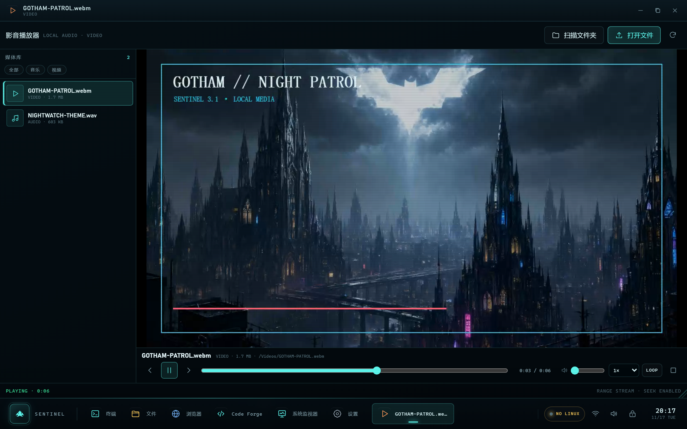
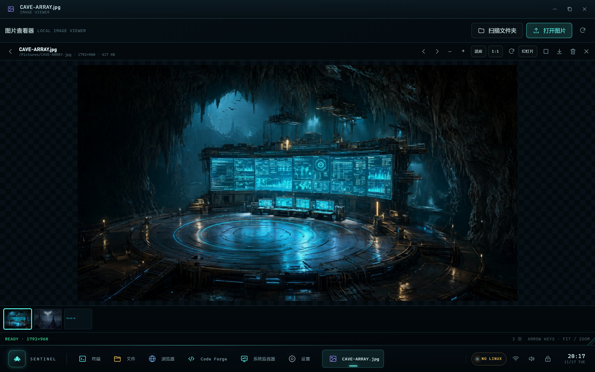

# BATCAVE OS 使用手册

适用于 BATCAVE OS 3.1.3 · SENTINEL。本手册从第一次启动写到每个面板的实际用途、数据位置与故障处理。更新机制另见 [更新说明](UPDATE.md)。

---

## 目录

1. [第一次启动](#1-第一次启动)
2. [桌面、窗口与快捷键](#2-桌面窗口与快捷键)
3. [文件、编辑器与笔记](#3-文件编辑器与笔记)
4. [终端](#4-终端)
5. [代码工坊](#5-代码工坊)
6. [浏览器与网络](#6-浏览器与网络)
7. [系统监视、安全中心与任务管理器](#7-系统监视安全中心与任务管理器)
8. [软件中心](#8-软件中心)
9. [办公套件与 PDF](#9-办公套件与-pdf)
10. [邮箱](#10-邮箱)
11. [播客、电台与音乐](#11-播客电台与音乐)
12. [内嵌应用](#12-内嵌应用)
13. [Chat-AI、气象站、地图、日历与定位工作站](#13-chat-ai气象站地图日历与定位工作站)
14. [系统更新](#14-系统更新)
15. [设置](#15-设置)
16. [Windows 基座：可启动 ISO 与 Windows To Go](#16-windows-基座可启动-iso-与-windows-to-go)
17. [数据、备份与迁移](#17-数据备份与迁移)
18. [故障排查](#18-故障排查)
19. [附录：参数、环境变量与端口](#19-附录参数环境变量与端口)

---

## 1. 第一次启动

### 1.1 运行环境

- Windows 10/11（推荐 x64）或 Linux。
- Node.js 18 或更高版本。无需 `npm install`。
- 浏览器：Edge / Chrome 等 Chromium 内核浏览器效果最佳。

### 1.2 启动服务

在项目目录打开终端：

```bash
node server.js
```

默认监听 `127.0.0.1:7777`，并自动打开浏览器。若端口被占用，服务会自动顺延到下一个可用端口，终端会打印实际地址。

Windows 用户也可以直接双击项目根目录的 `start-batcave.cmd`：脚本会先检查 `node` 是否在 PATH 中，再启动服务并保留控制台输出。需要静默启动（不显示控制台）时使用 `start-batcave.vbs`，Windows To Go 的快捷方式就是调用它。

只启动服务、不打开浏览器：

```bash
node server.js --no-open
```

指定端口与监听地址：

```bash
node server.js --port=8080 --host=127.0.0.1
```

### 1.3 直接打开 HTML 会怎样

不要双击 `public/index.html`。那样没有 Node 服务，页面能做一部分演示，但终端、文件、网络、邮件、更新等真实能力不可用，页面会提示"请通过 node server.js 启动"。

### 1.4 开机动画

启动后先播放约 2–3 秒的开机动画，逐行显示版本、主机、令牌状态、主目录、Shell 模式、Linux Core、代理与操作员。

- 点击画面或按任意非修饰键可跳过。
- 设置里关闭"动态效果"后，动画会缩短。

### 1.5 首次运行向导（OOBE）

第一次进入会要求建立本机档案：

1. 输入操作员呼号（最多 18 字符，留空则使用 `BRUCE`）。
2. 选择强调色：CYAN、CRIMSON、EMERALD、AMBER、VIOLET。
3. 选择壁纸。
4. 点击开始或按 Enter。

这只保存在本机浏览器，不是云账号，也没有密码与找回流程。

### 1.6 登录与锁屏

- 启动完成后显示登录页，点击"进入系统"或按 Enter。
- 本机会话不使用密码；提示会明确写出"无需密码 · 本机会话仅限本地访问"。
- 锁定后显示"解锁会话"，本地进程继续运行。快捷键 `Ctrl+Alt+L`。
- 注销会关闭所有窗口并回到登录页，但不会停止 Node 服务。

### 1.7 第一次进入桌面

桌面会自动打开一个终端窗口，并弹出通知"本地命令桥与文件系统已连接"。如果 WSL 可用，任务栏会显示 LINUX CORE 状态。

---

## 2. 桌面、窗口与快捷键

### 2.1 桌面图标

默认桌面图标顺序（`public/js/core.js` 的 `DESK` 数组）：

终端、文件、浏览器、Code Forge、办公套件、邮箱、系统监视器、设置、定位工作站、软件中心、TenSaint73OS、环球报阁、CodeForge AI、播客、网络电台、影音播放器、图片查看器、暗影保险库、Chat-AI。

- 双击打开。
- 右键桌面可打开右键菜单（新建、刷新、显示设置等，具体项以当前版本为准）。
- 桌面图标不会因为窗口遮挡而消失，最小化窗口即可看到。

### 2.2 开始菜单与启动器

- 点击任务栏左侧开始按钮，或按 `ALT+SPACE` / `Ctrl+Shift+E`。
- 启动器支持键盘：`↑` `↓` 选择，`Enter` 打开，`Esc` 关闭。
- 也可以直接输入应用名过滤（启动器输入框）。
- 启动器底部显示当前代号与版本。

### 2.3 窗口

每个窗口包含标题栏、最小化/最大化/关闭按钮与右下角缩放手柄。

- 拖动标题栏移动窗口。
- 双击标题栏最大化 / 还原。
- 拖动右下角手柄调整大小（有最小尺寸限制）。
- 任务栏显示正在运行的应用；点击可切换，再次点击当前应用可最小化。
- 关闭窗口只是关闭界面，内嵌应用的后台进程按各自生命周期管理；终端中正在运行的命令会在关闭窗口时中止。

### 2.4 通知与确认框

- 右下角通知用于操作结果、错误与状态提示。
- 危险操作（卸载、断网、格式化类命令）会弹出确认框，必须明确点击确认。
- 通知与音效可在设置中关闭。

### 2.5 快捷键

| 快捷键 | 功能 |
| --- | --- |
| `ALT+SPACE` | 打开 / 关闭开始菜单 |
| `Ctrl+Shift+E` | 打开 / 关闭开始菜单（备用） |
| `Ctrl+Alt+T` | 打开终端 |
| `Ctrl+Alt+F` | 打开文件管理器 |
| `Ctrl+Alt+B` | 打开浏览器 |
| `Ctrl+Alt+L` | 锁定工作站 |
| `Esc` | 关闭开始菜单 / 右键菜单 |
| `Enter` | 登录页进入系统；OOBE 确认 |
| `↑` `↓` `Enter` | 启动器内选择与打开 |

---

## 3. 文件、编辑器与笔记

### 3.1 文件管理器

打开"文件"应用，可浏览两类位置：

1. **虚拟文件系统**：位于程序目录 `data/` 下，随项目迁移。
2. **本机文件映射**：默认映射到 `~/Batcave`（Windows 为 `C:\Users\<你>\Batcave`），首次启动自动创建示例文件。

常用操作：

- 单击选中，双击进入目录或用编辑器打开文本文件。
- 新建文件夹、新建文件、重命名、删除。
- 上传与下载：把本机文件复制到映射目录，或把映射目录中的文件取出。
- 路径栏可直接输入路径跳转；所有路径都会被限制在映射根目录内，`..` 不能逃逸。
- 文本文件默认用内置编辑器打开；图片由图片查看器打开；音频与视频由影音播放器打开。其他二进制文件以下载方式处理。

### 3.2 编辑器

- 语法高亮、行号、保存、另存为。
- 适合编辑脚本、配置、Markdown 与普通文本。
- 保存时写入真实文件；关闭未保存的编辑器会提示。

### 3.3 代号笔记

"代号笔记"应用把笔记写入真实 `/Notes` 目录（映射根目录下），不是浏览器 localStorage。

- 新建、编辑、删除笔记。
- 笔记是普通文本文件，可用文件管理器或外部编辑器打开。
- 首次打开会生成一个示例标题 `# SENTINEL NOTES`。

### 3.4 示例文件

首次启动会在映射根目录生成：

- `README.md`：BATCAVE OS // SENTINEL 3.1 简介。
- `Documents/SENTINEL-BRIEFING.md`：示例夜间简报。
- `Projects/`：示例 Python 脚本等。
- `Pictures/`、`Music/`、`Videos/`、`Downloads/`、`Notes/`：空目录，分别供图片查看器、影音播放器、下载与代号笔记使用。

这些只是模板，可自由修改或删除。

---

## 4. 终端

### 4.1 真实命令桥

终端不是模拟器。每条命令都通过本机服务转发给真实的 Shell 进程，输出流式返回：

- Windows：PowerShell 7（若安装）、Windows PowerShell、CMD、Git Bash（若安装 Git for Windows）。
- WSL：检测到 WSL 时额外提供 `linux` 模式。
- Linux：`bash`，可选 `pwsh`。

终端顶部可切换 Shell 模式；不可用的模式会标注原因。

### 4.2 使用

- 输入命令后按 Enter。
- 输出按行流式显示；长时间命令可点击停止按钮中止。
- 支持当前工作目录、命令历史（上下键，具体行为以终端实现为准）与清屏。
- 关闭终端窗口会中止正在运行的命令。

### 4.3 安全限制

- 默认禁止破坏性命令（删除、格式化、关机等），需要显式 `--allow-destructive` 启动才放开。
- 危险命令还会要求二次确认。
- 命令以**当前 Windows 用户权限**运行，不是管理员权限；需要 UAC 的操作会由系统弹窗。
- 没有操作系统级沙箱。只运行你信任的命令与脚本。

### 4.4 Linux Core（WSL）

- 设置 → 系统与命令环境 → LINUX CORE 可查看状态。
- 不可用时，帮助按钮会在终端中给出安装指引；BATCAVE 不会在运行时强制安装 WSL。
- Windows To Go 镜像已离线启用 WSL 与虚拟机平台，首次仍需执行 `wsl --update` 与 `wsl --install -d Ubuntu`。

---

## 5. 代码工坊

### 5.1 支持的语言

JavaScript、TypeScript、Python、C、C++、Assembly (GNU)、ASCII / 编码、Rust、Go、Java、Ruby、PHP、Bash、PowerShell，以及自定义命令。

语言模板会生成一个最小可运行文件；运行按钮调用本机真实编译器 / 解释器：

- Node 直接执行 JS；Node 24+ 可执行 TypeScript（类型擦除）。
- C/C++ 使用 `gcc` / `g++`，汇编使用 GNU `as`。
- Rust 使用 `rustc`，Go 使用 `go run`。
- Java 使用 `javac` + `java`。
- PHP、Python、Ruby、Bash、PowerShell 使用对应解释器。

缺少运行时时，错误会如实显示，不会伪造成功。

### 5.2 自定义命令

选择"自定义命令"，在"运行命令"中使用 `{file}` 占位符，例如：

```text
lua {file}
perl {file}
Rscript {file}
```

要求对应运行时已安装并在 PATH 中。

### 5.3 编译器诊断

运行失败时，工坊会解析常见编译器输出并汇总：

- 文件、行、列、严重级别、消息。
- 最多展示 80 条，并统计错误与警告数量。
- 点击结果可跳到对应行。

支持 GCC / Clang、Rust、Go、Java、PHP、Python、Node、Bash 的常见格式。

### 5.4 HTML / CSS 静态诊断与预览

切换到 HTML/CSS 模式时：

- 检查标签栈、可选闭合标签、`<style>` 块行号偏移、CSS 声明与括号/字符串闭合。
- 结果可点击跳转。
- 预览使用 `sandbox="allow-scripts allow-modals"` 的 `srcdoc` iframe；每次刷新重建 iframe，避免 Chromium 复用旧文档。
- 预览中的脚本运行在沙箱内，不能直接访问桌面 API。

---

## 6. 浏览器与网络

### 6.1 安全浏览器

- 内置快捷入口：Wikipedia、Hacker News、GitHub、OpenStreetMap、Example、Internet Archive、MDN、DuckDuckGo。
- 地址栏可输入 URL。
- 风险域名会提示或拦截；下载进入隔离目录。
- 网页通过本机代理获取，代理会阻止回环、私有网段与云元数据地址（SSRF 防护）。

### 6.2 限制

- 不是完整 Chromium：复杂站点、登录态、视频 DRM 可能不工作。
- 需要登录的站点请使用系统浏览器。
- 代理只用于展示与安全隔离，不保证与真实浏览器完全一致。

### 6.3 网络设置

设置 → 网络与连接：

- **Wi-Fi**：扫描、连接、断开；开放网络直接连接，加密网络需要密码（WPA/WPA2 至少 8 位）。Wi-Fi 密码只通过一次性会话令牌发送给本机服务，不写盘、不写日志。
- **管理员扫描**：需要 UAC 的提升扫描。
- **位置权限**：跳转 Windows 位置隐私设置；Wi-Fi 扫描可能受该开关限制。
- **以太网**：查看适配器、IP、网关；启用 / 禁用 / 重新获取 IP（需要 UAC）。

---

## 7. 系统监视、安全中心与任务管理器

### 7.1 系统监视器

- 真实 CPU、内存、网络遥测。
- 以图表与数值展示；数据来自本机服务，不是随机动画。
- 可作为判断编译、下载、内嵌应用是否吃资源的依据。

### 7.2 安全中心

"安全中心"是本机态势检查，不是漏洞扫描器。点击"运行诊断"会检查：

- 会话执行令牌是否注入。
- 页面是否绑定在回环地址。
- WebCrypto 是否可用。
- 本地服务心跳。
- Linux Core 是否在线。
- 当前桥接模式。
- 安全边界：令牌 + Origin + 危险确认 + SSRF 防护。

还提供：

- **网络连通测试**：通过代理请求 `https://example.com`。
- **代理策略测试**：尝试请求 `http://127.0.0.1/`，验证 SSRF 防护是否拦截。
- **在终端中运行 neofetch**、**Linux Core 状态**。

### 7.3 任务管理器

- 列出当前窗口与真实进程快照。
- 可按进程名、内存等查看。
- 结束进程属于真实操作，请确认目标后再执行。

### 7.4 监控与性能建议

- 编译大型项目时关闭数字雨、扫描线与动态效果可降低浏览器占用。
- 内嵌 CodeForge 若复用本机 Java 运行时，首次启动会慢一些。
- 长时间下载更新时，终端与浏览器代理不要同时跑大流量任务。

---

## 8. 软件中心

软件中心有六个标签页：软件库 · winget、音乐客户端、游戏平台、游戏加速器、检查更新、已安装。

### 8.1 软件库 · winget

- 搜索真实 winget 源；可点快捷词。
- 结果显示包名、ID、版本与来源。
- 点击"安装"，由 winget 在本机真实执行；可能弹出 UAC 或安装向导。
- 安装输出实时显示，可停止任务。
- 系统不会伪造安装成功；失败会显示原始错误。

### 8.2 音乐客户端

- QQ 音乐、网易云音乐、酷狗音乐。
- 酷狗使用官方安装包通道（`download.kugou.com`），校验厂商签名后静默安装。
- 其他客户端按可用官方通道处理；没有可用通道时会明确提示。

### 8.3 游戏平台

- 检测 Steam、Epic Games、Ubisoft Connect、EA app、Xbox。
- 显示安装状态、版本与来源。
- 可启动、卸载、一键预置缺失平台、检查更新。
- 安装器来自厂商官方源（Xbox 走 Microsoft Store 源）。
- 游戏本体仍需在平台库内下载与更新；账号与购买关系归各平台。
- 兼容性口径：在 Windows 宿主上，平台与本机 Windows 使用同一内核、驱动与反作弊服务；平台内能玩的游戏，从这里启动后行为一致。Linux 基座不内置 WINE。

### 8.4 游戏加速器

- 内置网易UU加速器、雷神加速器、迅游加速器三张卡片。
- 每张卡片分别显示本机是否已安装、已安装版本、官网当前版本与是否有更新。
- “安装”或“更新”会先向 `lib/apps.js` 请求该厂商官网的最新 Windows 安装包地址，再在 PowerShell 中按以下顺序校验：HTTPS、下载主机必须属于该厂商白名单、文件扩展名必须为 `.exe`、Authenticode 状态必须为 `Valid`、签名主题必须匹配厂商关键词。任何一项不通过都会中止，不会运行安装器。
- 校验通过后启动厂商官方安装器，并等待其结束；随后读取注册表卸载项，确认安装确实发生。安装器已结束但注册表没有匹配项时，会如实提示“未检测到安装结果”，不伪造成功。
- 官网页面没有公布版本号时（例如迅游只提供安装文件），界面显示官网安装包日期，安装后再以文件版本为准。
- 三款软件的游戏加速效果、账号、会员与节点均由其官方客户端提供，BATCAVE 不代理、不绕过会员限制。

### 8.5 检查更新

- 使用 winget 官方清单检查已接管软件的更新。
- 显示检查时间与可更新数量。
- 更新仍由官方安装器执行。

### 8.6 已安装

- 枚举注册表卸载项与开始菜单应用。
- 可按名称卸载，调用程序自己的官方卸载器。
- 卸载不可撤销；个人数据、存档是否保留取决于程序自身。

---

## 9. 办公套件与 PDF

### 9.1 办公套件

- 接入微信、QQ、Office / WPS / LibreOffice。
- 提供文档入口与常用操作；具体能力取决于本机安装的办公软件。
- 不内置第三方安装包，缺失时会提示安装或跳转软件中心。

### 9.2 PDF

- 浏览 PDF。
- 页级编辑：旋转、删除、排序、合并、页码、导出。
- 编辑结果写入新文件，原文件默认保留。
- 复杂表单、数字签名与加密 PDF 可能不受支持。

---

## 10. 邮箱

### 10.1 支持的服务商

- QQ 邮箱
- 网易 163
- 网易 126
- 网易 yeah.net

通过真实 IMAP / SMTP / TLS 直连服务商，不经过第三方服务器。

### 10.2 授权码必须由你本人输入

BATCAVE 不会索要、代填、读取、上传或保存你的邮箱授权码。你需要在界面中亲自输入：

1. **QQ 邮箱**：`mail.qq.com` → 设置 → 账号 → 开启 IMAP/SMTP 服务 → 生成授权码。登录时"密码"填授权码。
2. **163 / 126 / yeah**：网页版 → 设置 → POP3/SMTP/IMAP → 开启 IMAP/SMTP → 新增客户端授权密码。
3. 服务商可能要求短信验证；按服务商流程完成。
4. 在 BATCAVE 邮箱面板输入邮箱地址与授权码，点击"登录邮箱"。

授权码只在单次请求的内存中存在，保留到退出或 30 分钟过期；不写磁盘、不写日志、不进入任何备份或更新包。

### 10.3 使用

- 左侧文件夹列表来自 IMAP。
- 收件箱列表显示发件人、主题、时间；点击读取正文与附件信息。
- 写邮件：收件人（多个用逗号分隔）、主题、正文，通过 SMTP/TLS 发送。
- 退出登录会丢弃内存中的授权码。
- 会话过期会提示重新登录。

### 10.4 常见问题

- **登录失败**：确认开启的是 IMAP/SMTP，而不是仅 POP3；确认使用的是授权码而不是网页登录密码。
- **企业邮箱**：自定义域名可能不在预置列表，需要手动选择服务商或使用标准 IMAP/SMTP 配置（以当前面板支持为准）。
- **附件**：面板显示附件名称与大小；大附件下载受服务商与网络限制。

---

## 11. 播客、电台与音乐

### 11.1 播客

- 多国目录、分类筛选、热门榜。
- 支持 HLS 流播放。
- 播放依赖网络；离线时显示错误，不会伪造节目。

### 11.2 网络电台

- 多国电台目录与自定义流 URL。
- 支持 HLS。
- 自定义流需要直接可访问的音频地址。

### 11.3 暗夜电台（合成音乐）

- WebAudio 实时生成，不依赖外部音频文件。
- 内置 NIGHTWATCH、GOTHAM RAIN、CAVE ARRAY、OMEGA PROTOCOL 等音色。
- 可调节音量与播放状态；关闭窗口即停止。

### 11.4 影音播放器

- 桌面、开始菜单与文件管理器都可打开。扫描 `/Music`、`/Videos`、`/Downloads`、`/Uploads`，也可点击"扫描文件夹"加入其他 Home 内目录。
- 支持 MP3、WAV、OGG、M4A、FLAC、AAC 与 MP4、M4V、WebM、MKV、MOV。
- 播放列表可按全部 / 音乐 / 视频过滤；支持上一首、下一首、暂停、进度拖动、音量、0.5×–2× 倍速、单曲循环与全屏。
- 视频通过 `/api/fs/raw` 的 HTTP Range 流式读取，拖动进度不需要先下载完整文件；浏览器不支持的编码会如实提示错误。
- "打开文件"会把本地文件上传到 `/Uploads` 后立即播放；也可以把音频 / 视频直接拖到播放器画面。
- 音频播放时显示旋转唱片与频谱；关闭窗口会停止播放并释放媒体资源。



### 11.5 图片查看器

- 扫描 `/Pictures`、`/Gallery`、`/Uploads`、`/Downloads`，也可加入其他 Home 内目录。
- 支持 PNG、JPG / JPEG、GIF、WebP、BMP、AVIF、SVG、ICO。
- 缩略图网格单击打开；预览支持适应窗口、1:1、放大 / 缩小、双击切换缩放、旋转 90°、上一张 / 下一张、幻灯片（5 秒）、全屏、下载与删除。
- 键盘：`←` / `→` 切换，`+` / `-` 缩放，`Esc` 返回网格。
- "打开图片"会把图片上传到 `/Gallery` 后打开；删除会直接作用于真实文件系统，操作前有确认框。
- 图片不会上传到云端；所有读取与写入都经过 Home 路径限制。



### 11.6 图像库

- 内置壁纸与本地上传图像。
- 上传的图片保存在浏览器或数据目录（以面板提示为准），不会上传到云端。
- 图像库用于壁纸与画廊浏览；需要缩放、旋转、幻灯片或删除文件时使用图片查看器。

---

## 12. 内嵌应用

内嵌应用由 `lib/embedded.js` 统一管理：按需启动、端口健康探测、退出时终止进程树。首次运行会把模板复制到 `data/apps/`，不修改发行包原件。

### 12.1 TenSaint73OS（端口 7781）

- 单管理员社区系统：论坛、文件、会员。
- 数据隔离到 `data/apps/tensaint`。
- 所有者身份来自用户桌面的 `.tsowner`；发行模板不包含 `auth.json`、`OWNER.pin`、`system.db`。
- 首次启动按应用内向导初始化；不要在多台机器间复制身份文件，除非你明确要迁移所有者。

### 12.2 环球报阁（端口 7782）

- 多语种报刊阅读、RSS、翻译、朗读。
- 数据目录 `data/apps/reading`。
- 阅读源依赖网络；部分站点可能限制抓取。

### 12.3 CodeForge AI 1.0.4（端口 7790）

- AI 编程中枢。
- 启动顺序：`BATCAVE_CODEFORGE_ROOT` → 桌面 `CodeForge-AI*` → `embedded/CodeForge-AI`。
- 优先复用本机完整安装（含模型与配置）；否则运行发行包自带精简版。
- 启动命令：`java --add-modules jdk.httpserver -jar CodeForgeServer.jar`，控制台路径 `/console/`。
- 精简版 `config.json` 中 API 密钥为空；BATCAVE 不复制外部 API 密钥。
- 需要本机 Java 运行时；缺失时面板会提示。

### 12.4 内嵌应用通用操作

- 打开面板 → 点击启动 → 等待健康检查通过 → 在窗口内使用。
- 停止会终止整棵进程树（Windows 使用 `taskkill /T /F`）。
- 应用数据在 `data/apps/`，备份时一并复制。
- 端口冲突时查看面板提示；可在 `lib/embedded.js` 调整端口。

---

## 13. Chat-AI、气象站、地图、日历与定位工作站

### 13.1 Chat-AI

- 本地规则对话助手，不冒充云端大模型。
- 可以打开应用、查询真实系统状态、把命令转交终端。
- 回答范围有限；复杂推理请使用专门的 AI 工具。
- 不会把你的对话上传到云端。

### 13.2 气象站

- 使用 Open-Meteo 真实天气数据。
- 支持按地点查询与多日预报。
- 需要网络；离线时显示错误。

### 13.3 哥谭网格

- 虚构城市的本地艺术地图，包含尖塔区、铁码头、灰烬街、霓虹市集、维斯珀湾。
- 可缩放、查看分区说明。
- "真实地图"按钮会在沙箱浏览器载入 OpenStreetMap。

### 13.4 日历

- 本地事件日历，数据保存在本机。
- 支持添加、查看、删除事件。
- 不连接云端日历，不发送提醒到外部服务。

### 13.5 定位工作站

- 内嵌 geo-windows 11 面板内核：① 总览、② 坐标与格式、③ 基站定位、④ 三角定位、⑤ 信号测距、⑥ GNSS 卫星、⑦ 天象定位、⑧ 联网与路由、⑨ 批处理导出、⑩ 历史收藏、⑪ 内核自检。
- 城市、国家与陆地数据随程序包分发（`public/geo/app/data/`），地图无需联网即可绘制；完整说明见 `public/geo/MANUAL.md`。
- 位置、基站、Wi-Fi、GNSS 等数据仅在本机计算；浏览器定位失败时会显示原因，不会伪造位置。
- 联网与路由面板调用本机桥接层；离线时显示错误。

---

## 14. 系统更新

### 14.1 快速步骤

1. 打开"系统更新"。
2. 选择 GitHub 或 GitCode。
3. 点击"检查更新"。
4. 有新版时点击"下载并安装"。
5. 完成后点击"重启 BATCAVE"。
6. 页面自动等待新版本上线；必要时手动刷新。

### 14.2 更新范围

只替换程序层，不碰 `data/`、`~/Batcave`、`node.exe`、Windows 与 U 盘分区。

### 14.3 失败怎么办

- 界面会显示具体阶段与错误；可重试或切换来源。
- 替换失败会自动回滚。
- 进程中断后，下次启动会自动恢复未完成事务。
- 详细日志与手动恢复见 [更新说明](UPDATE.md)。

### 14.4 离线环境

使用"完全手动升级"：下载 ZIP、校验 SHA-256、停止服务、覆盖程序文件、保留 `data/` 与 `node.exe`、重新启动。

---

## 15. 设置

设置分为五个区域：

### 15.1 外观与界面

- 强调色、壁纸。
- 扫描线、动态效果、数字雨、系统音效、12 小时制。
- 所有更改即时生效，保存在本机浏览器配置。

### 15.2 操作员账户

- 修改呼号（本机显示身份，不是远程账户）。
- 锁定工作站、注销。
- 提示文档、笔记与下载保存在真实主目录。

### 15.3 网络与连接

见 [6.3 网络设置](#63-网络设置)。

### 15.4 系统与命令环境

- RUNTIME：版本、代号、主机 / 用户、平台、主目录、Shell 模式。
- LINUX CORE：在线状态、引擎与发行版；帮助按钮、Homebrew 说明、运行 neofetch。
- SECURITY BOUNDARIES：本地 API 令牌、危险命令确认、网络代理 SSRF 防护。

### 15.5 关于

- 版本、技术栈、许可证。
- **重置本地界面配置**：清除呼号、主题、壁纸与桌面偏好并重新载入；不会删除主目录文件。此操作不可撤销。

---

## 16. Windows 基座：可启动 ISO 与 Windows To Go

BATCAVE 的基座有三条使用路径，均从你自己的官方 Windows 11 ISO 构建，不包含 Windows 密钥，也不修改激活：

1. **可启动 ISO**：像普通 Windows 安装盘一样启动，安装完成后自动带上 BATCAVE。适合“直接重装系统”。
2. **Ventoy + VHD**：把 VHD 放在 Ventoy 数据分区，启动时选择，不破坏盘中其他镜像。
3. **直写 U 盘**：把 VHD 展开到整块 U 盘，做成专用 Windows To Go 盘。

### 16.1 可启动 ISO：安装到本机硬盘

- ISO 保留官方 Windows 安装树，只在 `sources\$OEM$` 中加入 BATCAVE 程序、对应架构的 `node.exe`、 `SetupComplete.cmd` 与安装脚本。
- 用 Rufus、Ventoy 或厂商工具把 ISO 写入 U 盘，UEFI 启动后进入 **官方 Windows 安装界面**。分区、版本、账户与激活仍由你本人确认；BATCAVE 不会替你清盘或跳过选择。
- 安装完成、OOBE 之前，`SetupComplete.cmd` 会调用 `install-batcave.ps1`：把程序复制到 `C:\BATCAVE-OS`，授予 Users 修改权限（应用内更新需要替换程序层），创建公共桌面、开始菜单与所有用户启动快捷方式。
- 首次登录后自动以 Edge 全屏应用模式打开 BATCAVE；未出现时双击公共桌面的 `BATCAVE`。
- 运行数据写入当前用户的 `%LOCALAPPDATA%\BATCAVE-OS`，服务日志为同目录 `server.log`；程序层仍可被更新中心替换。
- x64 ISO 同时包含 BIOS 与 UEFI 引导；ARM64 ISO 为 UEFI 引导，只能在 ARM64 设备安装与启动。

### 16.2 Ventoy + VHD：非破坏性随身系统

- 把 `BATCAVE-Win11-Pro[-arm64].vhd` 复制到 Ventoy 数据分区。
- 下载 Ventoy 官方 `ventoy_vhdboot.img`，放到 U 盘的 `ventoy` 目录。
- UEFI 启动选择该 VHD；首次进入 OOBE，建议“我没有 Internet”→“继续执行受限设置”创建本地账户。
- Ventoy 按文件使用 VHD，不会清空 U 盘，也不影响盘中现有镜像。

### 16.3 直写 U 盘：专用 Windows To Go

- 需要 ≥64 GB U 盘与 ≥20 GB 的 C 盘临时空间。
- 以管理员身份运行 `iso\winbase\deploy-to-usb.ps1`；脚本只列出 USB 磁盘，要求输入磁盘编号并键入 `ERASE` 二次确认。
- 流程为只读挂载 VHD → 捕获临时 WIM → 重建 GPT（EFI + NTFS）→ 展开 → `bcdboot` → 架构校验，约 30–60 分钟。
- 该操作不可撤销，执行前备份 U 盘全部数据。

### 16.4 首次启动与激活

- 激活：设置 → 系统 → 激活，使用自己的正版许可。项目不分发密钥，也不修改激活状态。
- 驱动通过 Windows Update 或 OEM 获取；x64 可使用 NVIDIA / AMD / Intel 官方显卡驱动。
- WSL：管理员 PowerShell 执行 `wsl --update`，再 `wsl --install -d Ubuntu`，重启后创建 Linux 账户。

### 16.5 镜像构建与校验

见 [Windows 基座构建与部署](BUILD-ISO.md)。构建脚本：

- `iso\winbase\build-iso.ps1`：官方安装树 + `$OEM$` → 可启动 ISO，产物默认 `iso\out\BATCAVE-OS-3.1.3[-arm64].iso`。
- `iso\winbase\verify-iso.ps1`：只读挂载成品 ISO，校验 WIM 索引架构、El Torito 的 BIOS/UEFI 引导、载荷、快捷方式、禁入凭据与任务 HUD 缺失，输出 `VERIFY-ISO[-arm64].json`。
- `iso\winbase\build-winbase.ps1`：生成 Windows To Go VHD。
- `iso\winbase\verify-vhd.ps1`：只读挂载 VHD，校验分区、引导文件、程序载荷与 PE 架构。

x64 与 ARM64 共用脚本；ARM64 专业版索引通常为 3，并需要 win-arm64 的 `node.exe`。构建脚本会拒绝架构不匹配的 ISO 或 Node。

### 16.6 注意

- 可启动 ISO 与 VHD 已完成离线结构、WIM 架构与引导项校验，但尚未在实体硬件上完成启动回归；首次安装仍建议先在备用机或虚拟机验证。
- ARM64 镜像只能在 ARM64 设备启动；x64 宿主只能构建和离线校验。
- ISO 与 VHD 均包含微软 Windows 文件，仅限在自己的合法授权介质上为本机构建，项目不公开分发 Windows。
- 写入 U 盘会清空目标盘，先备份；Ventoy 方式不会清盘。
- 更新中心只更新 BATCAVE 程序层，不更新 Windows 本体、不更新 `node.exe`、不重建 ISO / VHD。

---

## 17. 数据、备份与迁移

### 17.1 数据位置

| 路径 | 内容 |
| --- | --- |
| `data/` | 虚拟文件系统、会话、内嵌应用数据 |
| `data/updates/` | 更新下载、暂存、备份、事务、历史 |
| `~/Batcave` | 默认本机文件映射根目录 |
| `data/apps/tensaint` | TenSaint73OS 数据 |
| `data/apps/reading` | 环球报阁数据 |
| `embedded/` | 内嵌应用发行包原件（不应手工修改） |

### 17.2 备份

停止服务后复制：

- 整个 `data/`
- 整个 `~/Batcave`
- 如需保留运行环境，再复制 `node.exe` 与项目源码（不含 `data`）

不要备份或复制 `.tsowner`、`OWNER.pin`、`auth.json`、`system.db` 到公开位置。

### 17.3 迁移到新机器

1. 安装 Node.js 18+。
2. 复制项目源码（或用 Release ZIP 解压）。
3. 复制备份的 `data/` 与 `~/Batcave`。
4. 启动 `node server.js`。
5. 如使用内嵌 CodeForge 完整版，重新配置其本机路径；BATCAVE 不携带 API 密钥。

### 17.4 重置

- 界面配置：设置 → 关于 → 重置本地界面配置。
- 应用数据：停止服务后删除对应 `data/apps/<app>`。
- 全部数据：停止服务后删除 `data/`，下次启动重新生成；此操作不可恢复。

---

## 18. 故障排查

| 现象 | 处理 |
| --- | --- |
| 页面提示需要 `node server.js` | 通过服务启动，不要直接打开 HTML |
| 端口被占用 | 服务会自动顺延；或 `--port=8080` |
| 终端命令无输出 | 切换 Shell 模式；检查命令是否存在；查看服务终端报错 |
| 终端提示命令被拦截 | 破坏性命令默认禁用；确需使用时以 `--allow-destructive` 启动并确认 |
| 文件路径报错 | 只能访问映射根目录内的路径；检查是否使用了 `..` 或绝对路径 |
| Wi-Fi 扫描为空 | 打开 Windows 位置服务；尝试"管理员扫描" |
| 以太网操作失败 | 需要 UAC；确认适配器名称与权限 |
| winget 搜索失败 | 确认 Windows 已安装 App Installer；网络可达 winget 源 |
| 游戏平台检测不到 | 平台可能安装在非默认路径；用"已安装"或平台自身检查 |
| 邮件登录失败 | 开启 IMAP/SMTP，使用授权码；确认服务商与端口 |
| 内嵌应用打不开 | 查看端口占用、运行时（Java/Node）与健康检查提示 |
| CodeForge 启动失败 | 检查 Java 17+、`BATCAVE_CODEFORGE_ROOT` 与 `CodeForgeServer.jar` |
| 更新检查超时 | 切换 GitHub/GitCode；确认网络；约 8 秒后会自动回退 |
| 更新 SHA 校验失败 | 重新下载；核对 Release 资产与清单 |
| 更新后仍是旧版 | 查看 `data/updates/restart.log` 与 `server.err.log`；手动重启 |
| 页面空白 | 强制刷新 Ctrl+F5；检查 `public/index.html` 是否完整 |
| 忘记呼号 | 呼号只是显示名，可在设置中修改，或在登录后重置界面配置 |

---

## 19. 附录：参数、环境变量与端口

### 19.1 命令行参数

| 参数 | 说明 |
| --- | --- |
| `--no-open` | 不自动打开浏览器 |
| `--port=<n>` | 端口，默认 7777，占用时顺延 |
| `--host=<addr>` | 监听地址，默认 127.0.0.1 |
| `--kiosk` | 全屏应用模式 |
| `--tui` | 无浏览器终端界面 |
| `--allow-local-net` | 允许局域网访问 |
| `--allow-destructive` | 允许破坏性命令 |
| `--home=<path>` | 本机文件映射根目录 |
| `--data=<path>` | 运行时数据目录 |

### 19.2 环境变量

| 变量 | 说明 |
| --- | --- |
| `BATCAVE_PORT` | 端口，优先级高于参数 |
| `BATCAVE_HOST` | 监听地址 |
| `BATCAVE_DATA` | 数据目录 |
| `BATCAVE_HOME` | 本机文件映射根目录 |
| `BATCAVE_ALLOW_LOCAL_NET=1` | 允许局域网 |
| `BATCAVE_ALLOW_DESTRUCTIVE=1` | 允许破坏性命令 |
| `BATCAVE_TOKEN` | 指定会话令牌；更新重启时由助手自动传递。不要公开分享 |
| `BATCAVE_GIT_BASH` | 自定义 Git Bash 路径 |
| `BATCAVE_CODEFORGE_ROOT` | CodeForge AI 完整安装目录 |

### 19.3 端口

| 端口 | 服务 |
| --- | --- |
| 7777（可顺延） | BATCAVE 主服务 |
| 7781 | TenSaint73OS |
| 7782 | 环球报阁 |
| 7790 | CodeForge AI |

所有服务默认仅本机可访问；开放局域网需显式参数。

### 19.4 日志

| 文件 | 内容 |
| --- | --- |
| 终端输出 | 服务启动、请求错误、桥接异常 |
| `server.out.log` / `server.err.log` | 重定向运行时日志（若使用启动脚本） |
| `data/updates/restart.log` | 更新重启助手日志，不含令牌明文 |
| `iso/out/*.log` | Windows To Go 构建与部署日志 |

日志可能包含主机名、用户名与文件路径。对外提交问题前请先检查并删除个人信息。
